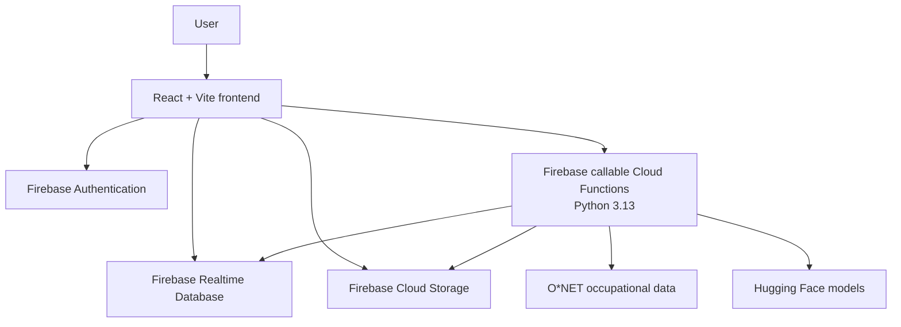

# SkillPath
SkillPath is a career-development web application that enables users to assess their current skills, explore occupations, identify potential skill gaps, and plan learning pathways to achieve career objectives.

## Contents

- [Overview](#overview)
- [Technology stack](#technology-stack)
- [Architecture and data flow](#architecture-and-data-flow)
- [Resume upload, extraction, and analysis](#resume-upload-extraction-and-analysis)
- [Data access and security](#data-access-and-security)
- [Getting started](#getting-started)
- [Firebase deployment](#firebase-deployment)
- [Development commands](#development-commands)
- [Repository structure](#repository-structure)
- [Licensing and acknowledgments](#licensing-and-acknowledgments)

## Overview

SkillPath is designed to make career exploration more actionable. Instead of only displaying job titles, the application connects users' existing experience and qualifications to the skills required for a target occupation, thereby identifying areas for professional development.

The planned high-level user journey is:

1. Create an account or sign in.
2. Provide resume text or upload a resume.
3. Extract text from the uploaded document and analyze the user’s stated experience, education, and skills.
4. Explore potential occupations and relevant occupational skill requirements.
5. Compare current skills against a chosen career target.
6. Review possible learning paths and track progress.

Note: Steps 4–6 reflect the application's intended purpose and proposed workflow. The precise implementation, ranking logic, and user experience have not been verified based on the files provided.

## Technology stack

| Layer | Technology | Purpose |
| --- | --- | --- |
| Frontend | React 19, React DOM | User interface |
| Build tooling | Vite 8, @vitejs/plugin-react | Local development and production builds |
| Navigation | React Router 7 | Client-side routing |
| State management | Redux, Redux Toolkit, React Redux, Redux Thunk | Shared application state and asynchronous flows |
| UI and styling | Bootstrap 5, React Bootstrap, Font Awesome | Responsive UI components and icons |
| Additional UI utilities | React Easy Crop, React Loading | Image cropping and loading indicators |
| Backend configuration | Firebase Cloud Functions (Python 3.13) | Server-side callable function runtime |
| Data storage | Firebase Realtime Database | User-scoped text, analysis metadata, and progress |
| File storage | Firebase Cloud Storage | Private uploaded resumes |
| Authentication | Firebase Authentication | Required by database and storage security rules |
| Quality tooling | Biome, Vitest | Linting/format checking and tests |
| Occupational data | O*NET | Integration not verified in reviewed files |
| Machine learning | Hugging Face | Models and integration not verified in reviewed files |

## Architecture and data flow



## Resume upload, extraction, and analysis

### Resume input

The existing project README describes two ways for a signed-in user to provide resume information:

- Save resume text directly.
- Upload a PDF or DOCX file smaller than 5 MiB.

Firebase Storage rules also permit the creation of text/plain files; however, support for extracting and analyzing uploaded .txt files has not been verified. This distinction between storage permissions and supported application workflows should be documented until the backend source is reviewed.

### File upload security

Uploaded files are stored under:

```text
resumes/{uid}/{fileName}
```

Rules enforce the following restrictions:
- The user must be authenticated and their UID must match the path.
- Uploads must be strictly smaller than 5 * 1024 * 1024 bytes.
- Allowed MIME types are application/pdf, text/plain, and the standard DOCX MIME type.
- The authenticated owner may create or delete a file, but cannot read or update it directly through client Storage rules.
- All other Storage paths are denied by the supplied catch-all rule.

A privileged backend using the Firebase Admin SDK can read uploaded files to perform extraction. Server-side code should validate file paths, types, lengths, and ownership independently of client-side restrictions.

### Text Extraction and Resume Analysis

The app transforms the DOCX or PDF resume into text and uses machine learning models from Hugging Face to extract the user's knowledge and skills. Additionally, occupational information from O\*NET is retrieved by using the O\*NET API and is used to perform a gap analysis by comparing a user's assessed knowledge and skills and the target role's required knowledge and skills.

Hugging Face models used:
[jjzha/jobbert_skill_extraction](https://huggingface.co/jjzha/jobbert_skill_extraction) for skill extraction
[jjzha/jobbert_knowledge_extraction](https://huggingface.co/jjzha/jobbert_knowledge_extraction) for knowledge extraction

### User data and progress

The supplied Realtime Database rules define user-scoped records under /users/{uid}. Examples of configured fields are:

```text
users/
{uid}/
profile
resumeText
resumePath
resumeFileName
resumeContentType
analyses/
{analysisId}
progress/
{analysisId}/
{skillId}
```

This is a description of paths referenced by rules, not proof that every field is populated by the running application.

## Data access and security

The rules deny access by default at the database root. At /users/{uid}, reads require an authenticated user with a matching UID. Client writes are restricted by path:

| Path | Client write access |
| --- | --- |
| profile | Denied |
| analyses | Denied |
| resumePath | Owner only; must begin with resumes/{uid}/ and be at most 512 characters |
| resumeFileName | Owner only; at most 255 characters |
| resumeContentType | Owner only; must equal the PDF or DOCX MIME type |
| resumeText | Owner only; at most 100,000 characters |
| progress/{analysisId} | Owner only, and only if the referenced analysis exists |
| Other user fields | Denied |

Progress values must be numeric and not exceed the server’s current time. Note: The database allows only PDF or DOCX MIME values in resumeContentType, whereas Storage also accepts text/plain. These rules should be aligned with the intended frontend behavior prior to supporting plain-text file uploads.

Sensitive resume content must not be logged or transmitted to third-party model services without explicit privacy and data-processing decisions. Secrets should be stored using supported server-side secret management solutions instead of being committed to the repository.

## Getting started

### Prerequisites

- Node.js and npm versions compatible with the installed Vite and Firebase dependencies.
- A Firebase project with the relevant services configured.
- Firebase CLI for deployment.
- Python 3.13 and Python dependencies if working on the Cloud Functions backend.

### Install frontend dependencies

```bash
git clone 
cd 
npm ci
```

### Configure Firebase

The repository contains a .firebaserc project alias and firebase.json configuration. Point your local Firebase CLI at the appropriate development project before deploying:

```bash
firebase login
firebase use --add
```

Do not deploy to the existing default project without verifying appropriate permissions and intent to modify it. Frontend Firebase initialization, required Vite environment variable names, and Python backend dependencies cannot be reliably documented without the missing source folders.

### Start local development

```bash
npm run dev
```

The dev server will display the local address to open in a browser.

### Build for production

```bash
npm run build
npm run preview
```

The preview command serves the generated production build locally for inspection. It does not deploy the application.

## Firebase deployment

firebase.json defines the Cloud Functions source as functions/, uses the Python 3.13 runtime, and associates the Database and Storage rules with their respective local files.

To deploy the configured backend functions and rules:

```bash
firebase deploy --only functions,database,storage
```

Review the selected Firebase project and ensure that the missing functions/ directory and its dependencies are present. The provided firebase.json does not specify a Hosting configuration; therefore, a frontend hosting deployment procedure cannot be determined from these files.

## Development commands

| Command | Description |
| --- | --- |
| `npm run dev` | Start the Vite development server |
| `npm run build` | Build the frontend with Vite |
| `npm run preview` | Preview the production frontend build |
| `npm run lint` | Run biome ci |
| `npm test` | Run the Vitest test suite once |

Biome is configured with recommended linting rules, tab indentation, double quotes for JavaScript, and organized imports.

## Repository structure

```text
skillpath-ai/
├── src/                    # React frontend (referenced by index.html; not supplied)
├── functions/              # Python Firebase Functions (configured; not supplied)
├── index.html              # HTML entry point
├── package.json            # Frontend dependencies and commands
├── package-lock.json       # Locked npm dependency tree
├── vite.config.ts          # Vite React plugin configuration
├── biome.json              # Biome lint and formatter configuration
├── firebase.json           # Firebase resource configuration
├── .firebaserc             # Firebase project alias
├── database.rules.json     # Realtime Database permissions and validation
├── storage.rules           # Private resume upload permissions
├── .gitignore              # Local/build/secret exclusions
└── README.md               # Project documentation
```

## Licensing and acknowledgments

This project includes information from [O*NET Web Services](https://services.onetcenter.org/) by the U.S. Department of Labor, Employment and Training Administration (USDOL/ETA). Used under the [CC BY 4.0](https://creativecommons.org/licenses/by/4.0/) license. O*NET® is a trademark of USDOL/ETA. This project has modified all or some of this information. USDOL/ETA has not approved, endorsed, or tested these modifications.

Hugging Face: Model licenses belong to their individual publishers or authors, as identified on each repository’s model card. Hugging Face itself is not a substitute for model-specific license review.

Frameworks and services: React, Vite, Firebase, Bootstrap, Redux, and other packages retain their own licenses and terms.
SkillPath is a career exploration and professional development project. Automated interpretations of resumes, job compatibility, or skill gaps are intended as informational support and do not constitute guarantees of employment, qualification, or career outcomes.
