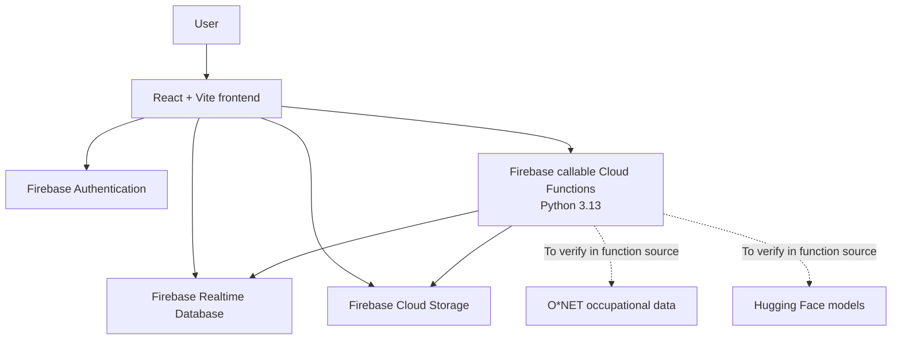

# SkillPath
SkillPath is a career-development web application that enables users to assess their current skills, explore occupations, identify potential skill gaps, and plan learning pathways to achieve career objectives.

The app integrates a React frontend with Firebase-supported user data management to allow users to login to the app and upload their resume. The app transforms the resume into text and uses machine learning models from Hugging Face to extract the user's knowledge ([jjzha
/jobbert_knowledge_extraction] (https://huggingface.co/jjzha/jobbert_knowledge_extraction)) and skills ([jjzha
/jobbert_skill_extraction] (https://huggingface.co/jjzha/jobbert_skill_extraction)).

Users are able to upload their resume in DOCX or PDF formatOccupational information from O\*NET and machine learning integrations using Hugging Face are included in the intended documentation scope. 

## Contents

- [Overview](#overview)
- [Features and implementation status](#features-and-implementation-status)
- [Technology stack](#technology-stack)
- [Architecture and data flow](#architecture-and-data-flow)
- [Resume upload, extraction, and analysis](#resume-upload-extraction-and-analysis)
- [Data access and security](#data-access-and-security)
- [O\*NET occupational information and attribution](#onet-occupational-information-and-attribution)
- [Hugging Face models and licenses](#hugging-face-models-and-licenses)
- [Getting started](#getting-started)
- [Firebase deployment](#firebase-deployment)
- [Development commands](#development-commands)
- [Repository structure](#repository-structure)
- [Known limitations and verification checklist](#known-limitations-and-verification-checklist)
- [Licensing and acknowledgments](#licensing-and-acknowledgments)

## Overview

SkillPath is designed to make career exploration more actionable. Instead of only displaying job titles, the application connects users' existing experience and qualifications to the skills required for a target occupation, thereby identifying areas for professional development.

The planned high-level user journey is:

1. Create an account or sign in.
2. Provide resume text or upload a resume.
3. Extract text from the uploaded document and analyze the user’s stated experience, education, and skills.
4. Explore potential occupations and relevant occupational skill requirements.
5. Compare current skills against a chosen career target.
6. Review possible learning paths and track progress.

Note: Steps 4–6 reflect the application's intended purpose and proposed workflow. The precise implementation, ranking logic, and user experience have not been verified based on the files provided.

## Features and implementation status

| Capability | Status based on supplied files | Notes |
| --- | --- | --- |
| React web application | Configured | React 19 and Vite 8 are declared in package.json. |
| Firebase integration | Configured | Firebase client SDK is a dependency; Realtime Database, Storage, and Python Cloud Functions are configured. |
| User authentication | Described; frontend not inspected | Existing README describes signed-in users; rules depend on Firebase Authentication. |
| Resume text storage | Described and covered by database rules | Owner-writable resumeText under /users/{uid}; max 100,000 characters. |
| Resume file uploads | Storage rules configured | Owner-create and owner-delete under resumes/{uid}/{fileName}; uploads must be smaller than 5 MiB. |
| Resume text extraction | Described; function source not inspected | Existing README names callable extract_resume_text for PDF/DOCX. |
| Rule-based resume analysis | Described; function source not inspected | Existing README names callable analyze_resume, with preliminary keyword-based matching. |
| Stored analyses | Schema/rules present | The /users/{uid}/analyses path is readable by its owner; client-side writes are disabled. |
| Learning progress tracking | Schema/rules present | Users can write timestamp-like skill progress entries for existing analyses, subject to validation. |
| O*NET occupation and skills integration | Unverified | Source code is required to determine the database version, API usage, data transformations, and attribution method. |
| Hugging Face models | Unverified | Model repository IDs, use cases, invocation code, and model-card licenses must be identified. |
| AI-generated recommendations | Not confirmed | The provided README specifies that the preliminary analyze_resume function does not generate AI recommendations. |

## Technology stack

| Layer | Technology | Purpose |
| --- | --- | --- |
| Frontend | React 19, React DOM | User interface |
| Build tooling | Vite 8, @vitejs/plugin-react | Local development and production builds |
| Navigation | React Router 7 | Client-side routing |
| State management | Redux, Redux Toolkit, React Redux, Redux Thunk | Shared application state and asynchronous flows |
| UI and styling | Bootstrap 5, React Bootstrap, Font Awesome | Responsive UI components and icons |
| Additional UI utilities | React Easy Crop, React Loading | Image cropping and loading indicators |
| Backend configuration | Firebase Cloud Functions (Python 3.13) | Server-side callable function runtime |
| Data storage | Firebase Realtime Database | User-scoped text, analysis metadata, and progress |
| File storage | Firebase Cloud Storage | Private uploaded resumes |
| Authentication | Firebase Authentication | Required by database and storage security rules |
| Quality tooling | Biome, Vitest | Linting/format checking and tests |
| Occupational data | O*NET | Integration not verified in reviewed files |
| Machine learning | Hugging Face | Models and integration not verified in reviewed files |

## Architecture and data flow

The confirmed configuration and documented resume workflow fit this architecture:



Confirmed by configuration: Firebase Functions point to functions/, Realtime Database security rules to database.rules.json, and Storage security rules to storage.rules.

Not yet confirmed: Whether O\*NET or Hugging Face is called from the backend, frontend, or another service; which endpoints or models are used; and whether the relevant features are active.

## Resume upload, extraction, and analysis

### Resume input

The existing project README describes two ways for a signed-in user to provide resume information:

- Save resume text directly.
- Upload a PDF or DOCX file smaller than 5 MiB.

Firebase Storage rules also permit the creation of text/plain files; however, support for extracting and analyzing uploaded .txt files has not been verified. This distinction between storage permissions and supported application workflows should be documented until the backend source is reviewed.

### File upload security

Uploaded files are stored under:

```text
resumes/{uid}/{fileName}
```

Rules enforce the following restrictions:
- The user must be authenticated and their UID must match the path.
- Uploads must be strictly smaller than 5 * 1024 * 1024 bytes.
- Allowed MIME types are application/pdf, text/plain, and the standard DOCX MIME type.
- The authenticated owner may create or delete a file, but cannot read or update it directly through client Storage rules.
- All other Storage paths are denied by the supplied catch-all rule.

A privileged backend using the Firebase Admin SDK can read uploaded files to perform extraction. Server-side code should validate file paths, types, lengths, and ownership independently of client-side restrictions.

### Text extraction

The existing README describes a callable function called extract_resume_text that accesses the signed-in user’s uploaded file with the Firebase Admin SDK and returns extracted text. The documentation specifies these limits:
- PDF input: maximum 50 pages.
- Returned/extracted text: maximum 100,000 characters.

These limits are documented in the existing README but not independently verified because the Python function source is not included in this upload.

### Resume analysis

The existing README describes the callable analyze_resume as identifying:
- Skills
- Education
- Experience
- Possible occupations

The current approach is described as a preliminary keyword-based rule set, rather than generative AI. This function should not be characterized as utilizing Hugging Face or generating personalized AI recommendations unless the implementation is confirmed.

### User data and progress

The supplied Realtime Database rules define user-scoped records under /users/{uid}. Examples of configured fields are:

```text
users/
{uid}/
profile
resumeText
resumePath
resumeFileName
resumeContentType
analyses/
{analysisId}
progress/
{analysisId}/
{skillId}
```

This is a description of paths referenced by rules, not proof that every field is populated by the running application.

## Data access and security

The rules deny access by default at the database root. At /users/{uid}, reads require an authenticated user with a matching UID. Client writes are restricted by path:

| Path | Client write access |
| --- | --- |
| profile | Denied |
| analyses | Denied |
| resumePath | Owner only; must begin with resumes/{uid}/ and be at most 512 characters |
| resumeFileName | Owner only; at most 255 characters |
| resumeContentType | Owner only; must equal the PDF or DOCX MIME type |
| resumeText | Owner only; at most 100,000 characters |
| progress/{analysisId} | Owner only, and only if the referenced analysis exists |
| Other user fields | Denied |

Progress values must be numeric and not exceed the server’s current time. Note: The database allows only PDF or DOCX MIME values in resumeContentType, whereas Storage also accepts text/plain. These rules should be aligned with the intended frontend behavior prior to supporting plain-text file uploads.

Sensitive resume content must not be logged or transmitted to third-party model services without explicit privacy and data-processing decisions. Secrets should be stored using supported server-side secret management solutions instead of being committed to the repository.

## ONET occupational information and attribution

ONET provides structured occupational information developed by the National Center for O\*NET Development and sponsored by the U.S. Department of Labor, Employment and Training Administration (USDOL/ETA). SkillPath is designed to utilize occupational data for job exploration and skill comparisons; however, the precise data source and integration mechanism must be confirmed within the application code.

Licensing requirements vary depending on the data source:

- Downloaded ONET Database: The ONET 31.0 Database is generally distributed under the Creative Commons Attribution 4.0 International (CC BY 4.0) license, subject to exceptions. Its required credit includes the database version, USDOL/ETA, a license link, and an indication of modifications. See the official database license.
- ONET Web Services API: API responses are governed by a separate Web Services data license, plus the Web Services terms. If SkillPath uses the API, credit and link to ONET Web Services in the application and follow the applicable terms. See the developer attribution guidance.
- Other ONET tools and third-party content: Career exploration tools and certain third-party materials may be subject to different licensing conditions. Do not assume that the Database license applies to these resources.

### Attribution text (use the applicable version)

If using unmodified downloaded ONET 31.0 Database content:
This application includes information from the ONET 31.0 Database by the U.S. Department of Labor, Employment and Training Administration (USDOL/ETA). Used under the CC BY 4.0 license. ONET® is a trademark of USDOL/ETA.

If SkillPath modifies downloaded ONET 31.0 Database content:
This application includes information from the ONET 31.0 Database by the U.S. Department of Labor, Employment and Training Administration (USDOL/ETA). Used under the CC BY 4.0 license. O\*NET® is a trademark of USDOL/ETA. The SkillPath project has modified some of this information. USDOL/ETA has not approved, endorsed, or tested these modifications.

If using ONET Web Services:
This application incorporates information from ONET Web Services by the U.S. Department of Labor, Employment and Training Administration (USDOL/ETA). O\*NET® is a trademark of USDOL/ETA.

Action required: Review the source code to determine the appropriate attribution, identify the specific O\*NET database version if downloads are used, and ensure attribution is displayed wherever required within the application. README attribution alone does not fulfill all obligations.

## Getting started

### Prerequisites

- Node.js and npm versions compatible with the installed Vite and Firebase dependencies.
- A Firebase project with the relevant services configured.
- Firebase CLI for deployment.
- Python 3.13 and Python dependencies if working on the Cloud Functions backend.

### Install frontend dependencies

```bash
git clone 
cd 
npm ci
```

### Configure Firebase

The repository contains a .firebaserc project alias and firebase.json configuration. Point your local Firebase CLI at the appropriate development project before deploying:

```bash
firebase login
firebase use --add
```

Do not deploy to the existing default project without verifying appropriate permissions and intent to modify it. Frontend Firebase initialization, required Vite environment variable names, and Python backend dependencies cannot be reliably documented without the missing source folders.

### Start local development

```bash
npm run dev
```

The dev server will display the local address to open in a browser.

### Build for production

```bash
npm run build
npm run preview
```

The preview command serves the generated production build locally for inspection. It does not deploy the application.

## Firebase deployment

firebase.json defines the Cloud Functions source as functions/, uses the Python 3.13 runtime, and associates the Database and Storage rules with their respective local files.

To deploy the configured backend functions and rules:

```bash
firebase deploy --only functions,database,storage
```

Review the selected Firebase project and ensure that the missing functions/ directory and its dependencies are present. The provided firebase.json does not specify a Hosting configuration; therefore, a frontend hosting deployment procedure cannot be determined from these files.

## Development commands

| Command | Description |
| --- | --- |
| `npm run dev` | Start the Vite development server |
| `npm run build` | Build the frontend with Vite |
| `npm run preview` | Preview the production frontend build |
| `npm run lint` | Run biome ci |
| `npm test` | Run the Vitest test suite once |

Biome is configured with recommended linting rules, tab indentation, double quotes for JavaScript, and organized imports.

## Repository structure

The uploaded configuration references the following layout:

```text
skillpath-ai/
├── src/                    # React frontend (referenced by index.html; not supplied)
├── functions/              # Python Firebase Functions (configured; not supplied)
├── index.html              # HTML entry point
├── package.json            # Frontend dependencies and commands
├── package-lock.json       # Locked npm dependency tree
├── vite.config.ts          # Vite React plugin configuration
├── biome.json              # Biome lint and formatter configuration
├── firebase.json           # Firebase resource configuration
├── .firebaserc             # Firebase project alias
├── database.rules.json     # Realtime Database permissions and validation
├── storage.rules           # Private resume upload permissions
├── .gitignore              # Local/build/secret exclusions
└── README.md               # Project documentation
```

The current index.html references /skillpath-ai/src/main.jsx as its module entry point. Confirm that this path aligns with the repository’s intended development base path and deployment configuration.

## Known limitations and verification checklist

The following items need source review before this documentation can be considered complete:

- [ ] Inspect src/ to document exact routes, screens, signup/login flows, resume forms, progress UI, and error handling.
- [ ] Inspect functions/ to confirm callable inputs/outputs, runtime dependencies, extraction limits, and analysis behavior.
- [ ] Identify any O\*NET API calls or bundled database files and the precise version and license.
- [ ] Identify all Hugging Face model repository IDs, model licenses, input/output handling, and whether any resume data leaves Firebase.
- [ ] Confirm whether a real skill-gap comparison and pathway recommendation engine is implemented.
- [ ] Confirm the actual environment variable names and local backend setup instructions.
- [ ] Confirm frontend hosting configuration and release procedure.
- [ ] Resolve the MIME-type mismatch between Storage’s TXT allowance and the database’s PDF/DOCX-only resumeContentType field.
- [ ] Verify the unusual absolute entry path in index.html for all expected environments.
- [ ] Run the frontend tests and lint command with the complete repository installed.

## Licensing and acknowledgments

This project includes information from [O*NET Web Services] (https://services.onetcenter.org/) by the U.S. Department of Labor, Employment and Training Administration (USDOL/ETA). Used under the [CC BY 4.0] (https://creativecommons.org/licenses/by/4.0/) license. O*NET® is a trademark of USDOL/ETA. This project has modified all or some of this information. USDOL/ETA has not approved, endorsed, or tested these modifications.

Hugging Face: Model licenses belong to their individual publishers or authors, as identified on each repository’s model card. Hugging Face itself is not a substitute for model-specific license review.

Frameworks and services: React, Vite, Firebase, Bootstrap, Redux, and other packages retain their own licenses and terms.
SkillPath is a career exploration and professional development project. Automated interpretations of resumes, job compatibility, or skill gaps are intended as informational support and do not constitute guarantees of employment, qualification, or career outcomes.
